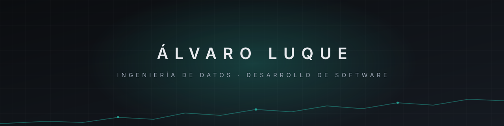

<a href="README.en.md">English</a> · <b>Español</b> &nbsp;&nbsp; 

<h3 align="center">Del dato en bruto a la aplicación que lo usa.</h3>

 

Hola, soy **Álvaro**, ingeniero informático por la Universidad de Málaga, especializándome en **ingeniería de datos**.

**Actualmente** curso el Máster en Ingeniería Informática con especialidad en Ingeniería de Datos, y en paralelo:

- Construyo proyectos propios de principio a fin: ingesta y procesamiento de datos, base de datos y la app o el dashboard que los usa.
- Me estoy especializando en ciberseguridad desde el lado de **GRC** (gobierno, riesgo y cumplimiento), donde voy a hacer prácticas: marcos como **ISO 27001**, el **ENS** o el **RGPD**, análisis de riesgos y auditoría.

**Anteriormente** hice prácticas como **Software Engineering Intern** en [Dedalus](https://www.dedalus.com) (software sanitario): integración de **HL7 y FHIR** con HAPI FHIR, APIs REST en **Spring Boot** y **Quarkus**, aplicaciones full stack con **Angular** y **MySQL**, pruebas con JUnit y Mockito, y despliegue con **Docker**.

> [!NOTE]
> Puedes escribirme a [alvaro31032003@gmail.com](mailto:alvaro31032003@gmail.com) o por [LinkedIn](https://www.linkedin.com/in/alvaro-luque-torres-33b614182).

## Tecnologías

<!-- tecnologias -->
<table>
<tr><th></th><th align="center">✅ <b>Experimentado</b></th><th align="center">🔁 <b>Experimentando</b></th><th align="center">🆕 <b>Experimentar</b></th></tr>
<tr><td>🧩 Lenguajes</td><td align="center">   </td><td align="center"> </td><td align="center"> </td></tr>
<tr><td>📊 Datos</td><td align="center">    </td><td align="center"> </td><td align="center">   </td></tr>
<tr><td>🗂️ Bases de datos</td><td align="center"> </td><td align="center"></td><td align="center"> </td></tr>
<tr><td>🛠️ Frameworks</td><td align="center">  </td><td align="center">  </td><td align="center"></td></tr>
<tr><td>📦 Contenedores y cloud</td><td align="center"> </td><td align="center">   </td><td align="center"> </td></tr>
<tr><td>🛡️ Ciberseguridad y GRC</td><td align="center"></td><td align="center">  </td><td align="center">  </td></tr>
<tr><td>🐙 Calidad y versiones</td><td align="center">   </td><td align="center"></td><td align="center"></td></tr>
<tr><td>🏥 Estándares sanitarios</td><td align="center"> </td><td align="center"></td><td align="center"></td></tr>
<tr><td>📜 Documentación</td><td align="center">  </td><td align="center"></td><td align="center"></td></tr>
</table>
<!-- /tecnologias -->

## Portfolio

| Proyecto | Qué es | Stack |
|---|---|---|
| [**Jungle Clear Tracker**](https://github.com/xAllow/jungle-clear-tracker) | App de escritorio que mide el primer clear de jungla en League of Legends con ~0,5 s de precisión y reconstruye las posiciones desde el replay. Código abierto. | Python · Tkinter · matplotlib |
| [**Panel de vida**](https://datos-lol.vercel.app) | Dashboard personal: más de 760 partidas de LoL y más de 600 días de pasos, con ETL propio a MongoDB. | Next.js · TypeScript · MongoDB · Python |
| **Traze** | App Android que convierte una carrera de Strava o un GPX en un sticker para stories de Instagram. | Kotlin · Android · Strava API |
| [**Montilla Pasión Go**](https://montillapasiongo.app) | Web de la Semana Santa de Montilla: hermandades, recorridos en mapa y estado en directo. | Next.js · Supabase · Leaflet |
| **TFG** | Análisis de logs para estudiar el comportamiento de los usuarios de una web de diseño de interiores. | Python · Jupyter · Grafana · Docker |

<a href="https://xallow.github.io"><b>Ver CV y portfolio completo →</b></a>

